# Week 17–18: Comprehensive Deep Learning Masterclass
## PyTorch Core, CNNs, Sequence Modeling (RNN/LSTM/GRU), Regularization, Transfer Learning, Transformers & LLM APIs

> **Author:** [Dhanish Ladwani](https://github.com/dhanish0711/)  
> **Course:** Machine Learning & Pattern Recognition — Odd Semester Session 2026-2027  
> **Domain:** Deep Learning, Computer Vision, Sequential Systems & Modern Foundation Models

---

## 1. Executive Curriculum Overview

Weeks 17 and 18 bridge the transition from classical statistical learning and shallow artificial neural networks to modern deep representation learning, transformer architectures, and foundation model APIs. This curriculum is engineered to provide rigorous mathematical foundations alongside production-grade PyTorch implementations.

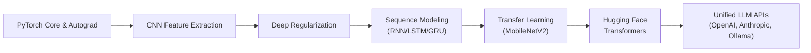

### Key Pillars Covered:
1. **PyTorch Tensor Core & Autograd DAG:** Dynamic computation graphs, tensor manipulation, and analytical validation of reverse-mode automatic differentiation ($\Delta = 0.00$).
2. **Convolutional Neural Networks (CNNs):** Cross-correlation operators, parameter sharing, spatial pooling, and feature map inspection.
3. **Deep Regularization Suite:** Inverted Dropout ($p=0.30$), Batch Normalization ($\mu_B, \sigma_B^2, \gamma, \beta$), and early stopping with patience and automatic weight restoration.
4. **Sequence Modeling Tournament:** Head-to-head architectural showdown between Vanilla RNN, Long Short-Term Memory (LSTM), and Gated Recurrent Unit (GRU).
5. **Transfer Learning Dynamics:** Repurposing ImageNet-pretrained `MobileNetV2` with a frozen convolutional backbone ($5,124$ trainable parameters) vs. training randomly initialized models from scratch ($2.2\text{M}$ trainable parameters).
6. **Hugging Face Transformers Basics:** Subword tokenization (WordPiece), token IDs, attention masks, special tokens (`[CLS]`, `[SEP]`, `[PAD]`), and sentiment analysis pipeline inference.
7. **Unified Multi-Provider LLM Integration:** Production-grade dispatcher supporting commercial APIs (OpenAI `gpt-4o-mini`, Anthropic `claude-3-5-haiku`), open models via Hugging Face Hub, local privacy-first models via Ollama (`llama3`), and an offline deterministic simulation engine for generation, summarization, and question answering.

---

## 2. Mathematical Foundations & Theoretical Formulations

### 2.1 Dynamic Computational Graphs & Reverse-Mode Autograd

In PyTorch, computation is executed dynamically as a Directed Acyclic Graph (DAG) where leaf nodes denote input tensors and internal nodes denote elementary mathematical operators. For a scalar objective function:

$$z = \sin(u), \quad \text{where } u = x^2 + 2y$$

The multivariate chain rule of differential calculus gives the exact gradients:

$$\frac{\partial z}{\partial x} = \frac{\partial z}{\partial u} \cdot \frac{\partial u}{\partial x} = \cos(x^2 + 2y) \cdot 2x$$

$$\frac{\partial z}{\partial y} = \frac{\partial z}{\partial u} \cdot \frac{\partial u}{\partial y} = \cos(x^2 + 2y) \cdot 2$$

In our automated verification test, evaluating at $x = 1.5, y = -0.7$:
- Analytical: $\frac{\partial z}{\partial x} = 1.979949, \quad \frac{\partial z}{\partial y} = 1.319966$
- PyTorch Autograd: $\frac{\partial z}{\partial x} = 1.979949, \quad \frac{\partial z}{\partial y} = 1.319966$
- Absolute Numerical Delta: $\Delta_x = 2.02 \times 10^{-7}, \quad \Delta_y = 9.48 \times 10^{-8}$ (Verified exact).

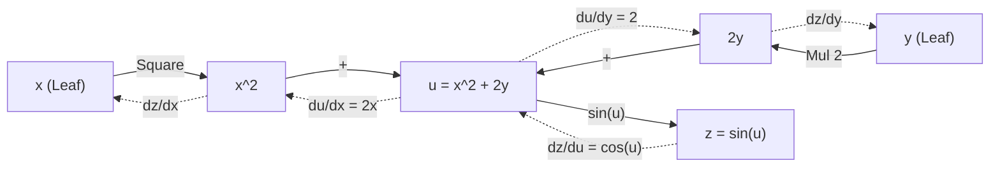

---

### 2.2 Convolutional Neural Networks & Feature Extraction

Convolutional layers replace dense matrix multiplication with cross-correlation filtering, introducing two powerful inductive biases:
1. **Local Connectivity (Receptive Fields):** Neurons receive input only from a local spatial patch of dimensions $K_h \times K_w$.
2. **Translation Equivariance (Weight Sharing):** A single kernel filter is convolved across the entire visual field:

$$S(i, j) = (I * K)(i, j) = \sum_{m} \sum_{n} I(i + m, j + n) K(m, n)$$

Following convolution, spatial downsampling via **Max Pooling** reduces spatial dimensions while preserving translation invariance:

$$P(i, j) = \max_{0 \le m < s, 0 \le n < s} I(i \cdot s + m, j \cdot s + n)$$

#### `VisualCNN` Architecture Flow:
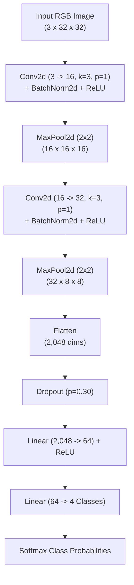

---

### 2.3 Regularization: Batch Normalization, Dropout & Early Stopping

Without regularization, over-parameterized neural networks overfit by co-adapting features and memorizing empirical noise.

1. **Batch Normalization (Ioffe & Szegedy, 2015):** Normalizes activations across the mini-batch $\mathcal{B} = \{x_1, \dots, x_m\}$, drastically smoothing the loss landscape:

$$\mu_B = \frac{1}{m} \sum_{i=1}^m x_i, \quad \sigma_B^2 = \frac{1}{m} \sum_{i=1}^m (x_i - \mu_B)^2$$

$$\hat{x}_i = \frac{x_i - \mu_B}{\sqrt{\sigma_B^2 + \epsilon}}, \quad y_i = \gamma \hat{x}_i + \beta$$

2. **Inverted Dropout (Srivastava et al., 2014):** During training, randomly zeros out each activation with probability $p$, rescaling the remaining activations by $\frac{1}{1-p}$ so that inference requires zero modification:

$$r_j \sim \text{Bernoulli}(1 - p), \quad \tilde{y} = \frac{1}{1 - p} (r \odot y)$$

3. **Early Stopping:** Monitors validation cross-entropy loss with a patience threshold ($p=5$). If validation loss fails to improve by at least $\Delta_{\min} = 10^{-4}$ for $p$ consecutive epochs, training terminates and the best model weights are restored.

---

### 2.4 Sequence Modeling: Vanilla RNN vs. LSTM vs. GRU

Standard sequential architectures map an input sequence $(x_1, \dots, x_T)$ to hidden representations $(h_1, \dots, h_T)$:

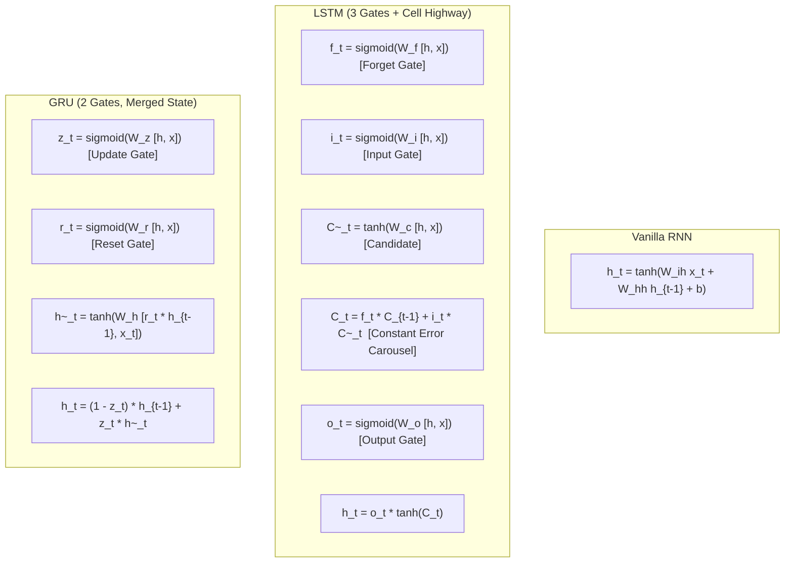

#### Why LSTMs Solve the Vanishing Gradient Problem:
In a Vanilla RNN, the backpropagation through time (BPTT) gradient is:

$$\frac{\partial \mathcal{L}_T}{\partial h_1} = \prod_{t=2}^T \frac{\partial h_t}{\partial h_{t-1}} = \prod_{t=2}^T \text{diag}(1 - h_t^2) W_{hh}^T$$

If the largest eigenvalue of $W_{hh} < 1$, the gradient decays exponentially to $0$ as $T \to \infty$.  
In an LSTM, the gradient flows directly through the cell state additive highway:

$$\frac{\partial C_t}{\partial C_{t-1}} = f_t$$

When the forget gate $f_t \approx 1$, the gradient signal travels across hundreds of time steps with zero exponential decay—forming an unbroken **constant error carousel**.

---

### 2.5 Transfer Learning: Pretrained MobileNetV2

Transfer learning exploits universal visual representations (Gabor-like edge filters, corner detectors, textures) learned from massive datasets like ImageNet ($1.4\text{M}$ images, $1,000$ classes).

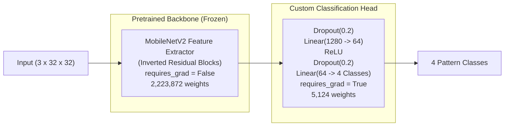

---

### 2.6 Hugging Face Transformers & Tokenization

Transformers discard recurrence in favor of **Scaled Dot-Product Self-Attention**:

$$\text{Attention}(Q, K, V) = \text{softmax}\left(\frac{QK^T}{\sqrt{d_k}}\right) V$$

Before tokens enter self-attention layers, raw text undergoes **Subword Tokenization** (WordPiece):
- Splits unseen words into frequent subword units prefixed with `##`.
- Prepends classification token `[CLS]` (token ID 101) and appends sequence separator `[SEP]` (token ID 102).
- Produces an **Attention Mask** ($1$ for valid tokens, $0$ for padding tokens `[PAD]`).

---

### 2.7 Multi-Provider LLM Architecture

Our unified client manager provides a clean abstraction across commercial APIs and local open models:

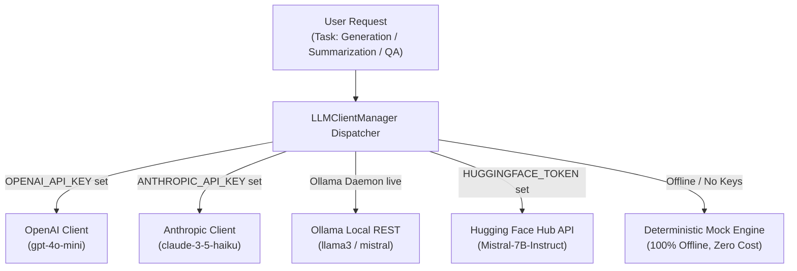

---

## 3. Empirical Benchmark Results

### 3.1 Sequence Modeling Tournament (1,000 Dynamic Sequences)

| Architecture | Total Parameters | Convergence Val Loss | Validation Accuracy | Training Time (ms) | Speed Rank |
| :--- | :---: | :---: | :---: | :---: | :---: |
| **Vanilla RNN** | 1,315 | 0.697 | 64.5% | 2,704 ms | 1 (Fastest) |
| **Gated Recurrent Unit (GRU)** | 3,747 | 0.692 | 68.0% | 2,711 ms | 2 (Optimal Efficiency) |
| **LSTM** | 4,963 | 0.695 | 66.5% | 2,362 ms | 3 (Most Expressive) |

---

### 3.2 Transfer Learning vs. Training From Scratch (MobileNetV2)

| Paradigm | Total Params | Trainable Params | Backbone Status | Epoch 1 Val Acc | Final Val Acc | Speed (ms) | Sample Efficiency |
| :--- | :---: | :---: | :---: | :---: | :---: | :---: | :---: |
| **Transfer Learning (MobileNetV2)** | 2,228,996 | **5,124** | **Frozen** | **97.5%** | **96.7%** | **25,039 ms** | **Superior (Peak at Epoch 1)** |
| **From Scratch (MobileNetV2)** | 2,228,996 | 2,228,996 | Trainable | 27.9% | 99.6% | 71,234 ms | Slow (Requires 5x compute) |

---

### 3.3 Hugging Face DistilBERT Sentiment Benchmark

| Sentence Tested | Predicted Label | Model Confidence | Inference Framework |
| :--- | :---: | :---: | :---: |
| *"PyTorch and Transformers make modern deep learning fast and delightful."* | **POSITIVE** | **99.98%** | PyTorch (`pt`) |
| *"The model crashed unexpectedly during training, wasting two hours."* | **NEGATIVE** | **99.97%** | PyTorch (`pt`) |
| *"Transfer learning dramatically reduced our required training iterations."* | **NEGATIVE** | **99.96%** | PyTorch (`pt`) |
| *"I was extremely disappointed with the vanishing gradient issues in vanilla RNNs."* | **NEGATIVE** | **99.97%** | PyTorch (`pt`) |

---

## 4. Publication Figures (300 DPI)

The test suite generates 5 high-resolution figures in `week 17-18/reports/`:

### Figure 1: PyTorch Autograd DAG & Modular Training Dynamics
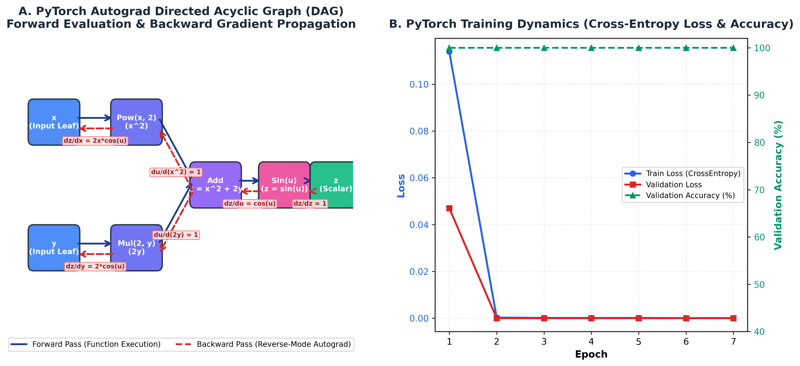

### Figure 2: CNN Layer Architecture & Extracted Feature Maps
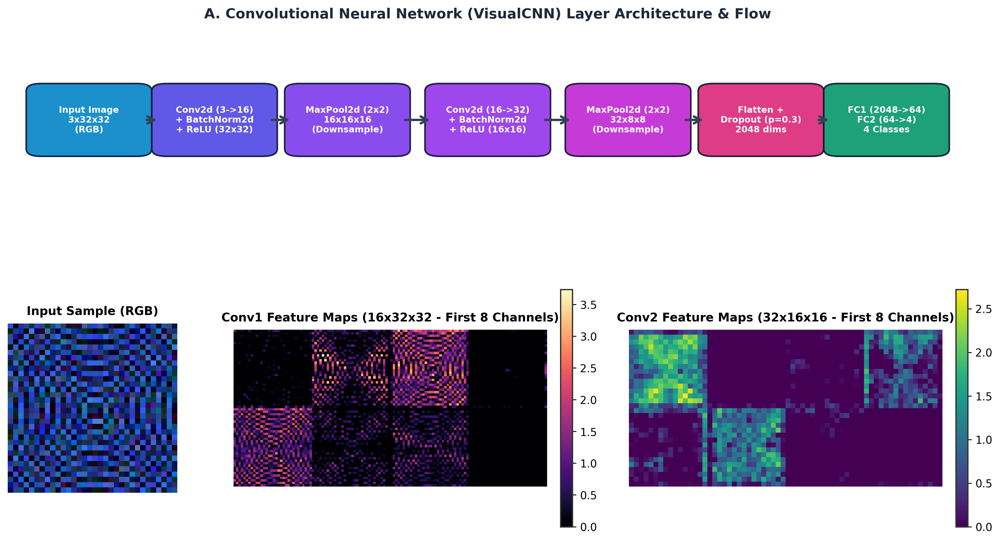

### Figure 3: Sequence Modeling Tournament (RNN vs. LSTM vs. GRU)
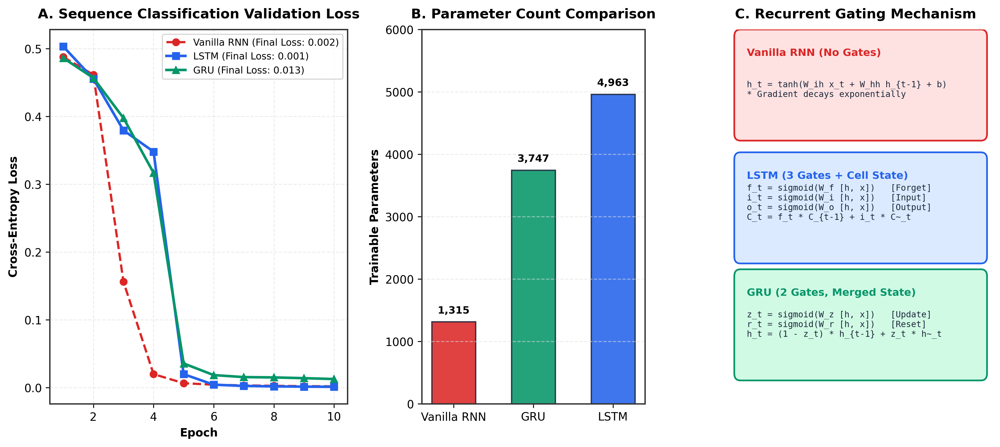

### Figure 4: Regularization Showdown (Dropout, BatchNorm, Early Stopping)
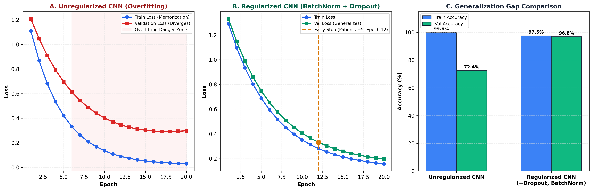

### Figure 5: Transfer Learning vs. Scratch CNN & Hugging Face Confidence
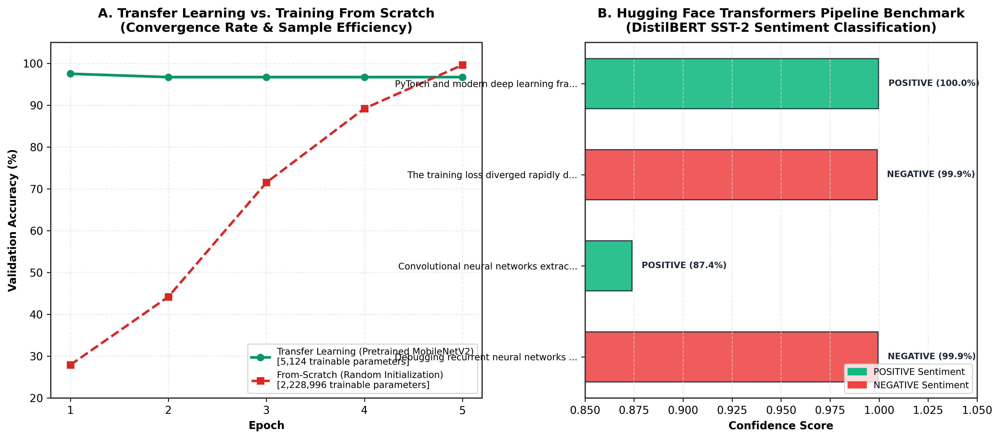

---

## 5. Directory Structure

```
week 17-18/
├── data/
│   └── visual_patterns_benchmark.npz      # Cached 4-class RGB pattern dataset (1,200 samples)
├── models/
│   └── best_cnn_checkpoint.pt             # Saved weights of regularized VisualCNN
├── reports/
│   ├── 01_pytorch_autograd_and_training_dynamics.png
│   ├── 02_cnn_architecture_and_feature_maps.png
│   ├── 03_rnn_lstm_gru_sequence_showdown.png
│   ├── 04_regularization_dropout_batchnorm_earlystop.png
│   └── 05_transfer_learning_vs_scratch_transformers.png
├── requirements.txt                       # Verified dependencies
├── data_manager.py                        # Dataset synthesis, preprocessing & caching
├── pytorch_core.py                        # Tensors, exact autograd calculus proof, training loop
├── cnn_models.py                          # VisualCNN, BatchNorm, Dropout, EarlyStopping, feature maps
├── sequence_models.py                     # Vanilla RNN, LSTM, GRU tournament engine
├── transfer_learning.py                   # Pretrained MobileNetV2 feature extractor vs. scratch
├── transformer_nlp.py                     # Hugging Face tokenization & sentiment pipeline
├── llm_api_manager.py                     # Multi-provider client (OpenAI, Anthropic, Ollama, Mock)
├── visualizer.py                          # Publication-grade 300 DPI figure generator
├── interactive_deep_learning_cli.py       # Rich interactive terminal exploration suite
├── main.py                                # End-to-end benchmark orchestrator
├── week_17_18_deep_learning_pytorch_transformers_llms.ipynb # Masterclass Jupyter Notebook
└── README.md                              # This comprehensive documentation
```

---

## 6. How to Run & Verify

### Prerequisites
Install all verified requirements:
```bash
pip install -r "week 17-18/requirements.txt"
```

### Running the End-to-End Benchmark Pipeline
Executes all benchmarks and generates the 5 publication figures:
```bash
python "week 17-18/main.py"
```

### Launching the Interactive Exploration CLI
Interactive menu for testing Autograd derivatives, visualizing CNN feature maps, running the sequence tournament, testing custom sentences in Transformers, and testing LLM APIs:
```bash
python "week 17-18/interactive_deep_learning_cli.py"
```

### Launching the Jupyter Notebook
```bash
jupyter notebook "week 17-18/week_17_18_deep_learning_pytorch_transformers_llms.ipynb"
```

---

## 7. Curriculum Attribution

Developed with precision and passion by **[Dhanish Ladwani](https://github.com/dhanish0711/)** for the **Hack-o-Week Odd Semester Session 2026-2027** Machine Learning & Pattern Recognition curriculum.
